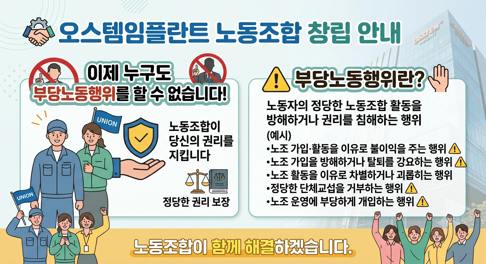
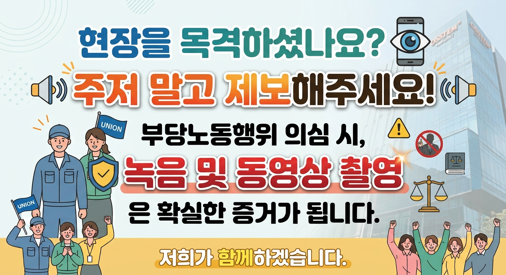

노동조합 활동과 조합원의 권리를 지키기 위해 부당노동행위 제보를 받습니다.

## 부당노동행위란?

노동자의 정당한 노동조합 활동을 방해하거나 권리를 침해하는 행위입니다. 예를 들면 다음과 같습니다.

- 노조 가입·활동을 이유로 불이익을 주는 행위
- 노조 가입을 방해하거나 탈퇴를 강요하는 행위
- 노조 활동을 이유로 차별하거나 괴롭히는 행위
- 정당한 단체교섭을 거부하는 행위
- 노조 운영에 부당하게 개입하는 행위

## 제보 방법

부당노동행위가 의심되거나 노조 활동 중 어려움을 겪고 계시면 **상담·제보 오픈채팅**으로 알려주세요. 보내주신 내용은 조합원 권익 보호를 위해서만 쓰입니다.
